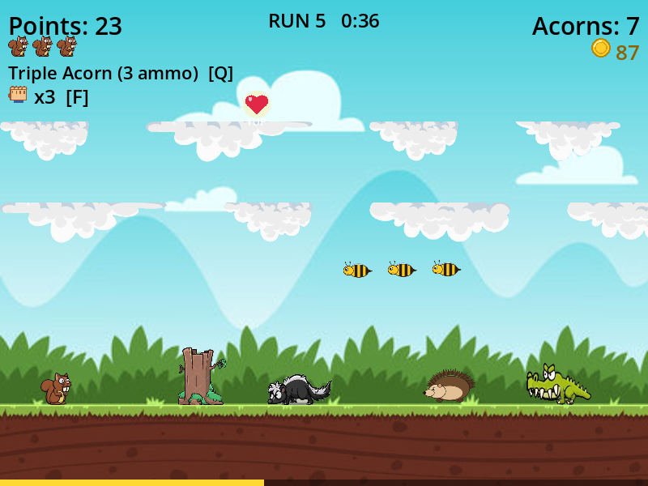

# Squirrel

A side-scrolling game starring a squirrel, built with Godot 4. The project lives in [`godot/`](godot/README.md).



```bash
make run     # play from source (windowed)
make web     # export the HTML5 build   -> godot/build/web/  (then: make serve)
make macos   # export the macOS app     -> godot/build/macos/Squirrel.app (full screen)
make test    # headless smoke test
```

See `make help` for all targets and [`godot/README.md`](godot/README.md) for controls and layout.
